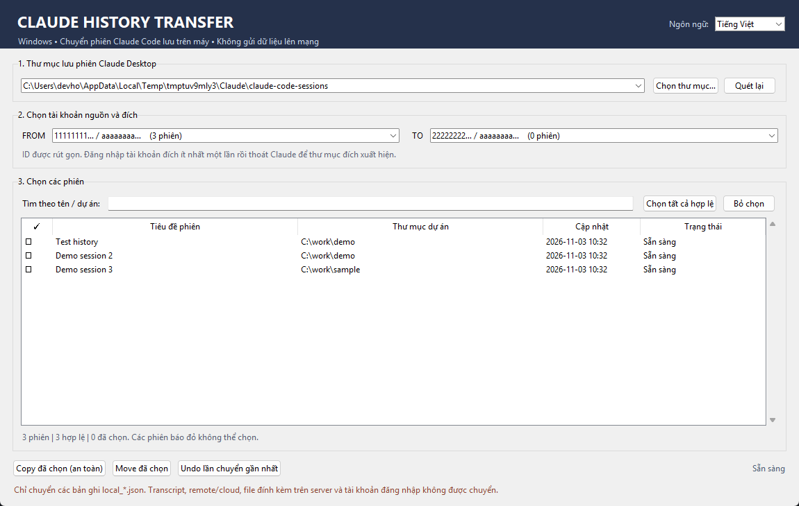

# Claude History Transfer for Windows (v0.0.1)

[English](README.md) · [Tải về (Releases)](https://github.com/austinhoang8386/claude-history-windows/releases)

**Ứng dụng song ngữ: mặc định English, có thể chuyển sang Tiếng Việt; dành cho Windows 10/11.** Tự phát hiện tài khoản Claude Desktop, chọn và chuyển card lịch sử Claude Code giữa các tài khoản. Độc lập với Anthropic, không phải bản phát hành chính thức của dự án `claude-transplant`.

## Bắt đầu

1. Cài **Python 3.10+** từ https://www.python.org/downloads/windows/ (chọn **Add Python to PATH**). Không cần pip hoặc thư viện bên ngoài.
2. Giải nén toàn bộ thư mục và nhấp đúp **`Start-Windows.bat`**.
3. Trong Claude Desktop, đăng nhập lần lượt **tài khoản nguồn** và **tài khoản đích** ít nhất một lần. Mỗi tài khoản nên có thư mục riêng dưới `claude-code-sessions`. Nếu đích chưa xuất hiện, mở tab Code rồi đóng Claude Desktop và bấm **Quét lại**.
4. **Thoát hoàn toàn Claude Desktop trong system tray** và dừng mọi tiến trình `claude.exe` / Claude Code CLI trước khi quét và chuyển.
5. Chọn đúng thư mục `claude-code-sessions` nếu có nhiều root; chọn **FROM** và **TO** (ID rút gọn). Kiểm tra kỹ ID thư mục bằng File Explorer vì email có thể không được xác định an toàn từ card.
6. Chọn từng phiên qua cột checkbox hoặc **Chọn tất cả hợp lệ**. Nên thử **Copy đã chọn (an toàn)** với 1–2 phiên trước, kiểm tra lại trong Claude Desktop tài khoản đích.
7. Khi kiểm tra tốt, chọn tiếp **Copy** hoặc **Move**. Nếu muốn quay lại, thoát Claude Desktop rồi dùng **Undo lần chuyển gần nhất**.

## Đổi ngôn ngữ

- Lần đầu mở chương trình, giao diện **mặc định là English**.
- Ở góc trên bên phải có mục **Language**. Chọn **Tiếng Việt** để chuyển toàn bộ giao diện, trạng thái kiểm tra phiên và hộp thoại sang tiếng Việt. Có thể đổi lại **English** ngay mà không cần khởi động lại.
- Cài đặt được lưu ở `%LOCALAPPDATA%\ClaudeHistoryWindows\settings.json` và được giữ cho những lần mở sau. Muốn đặt lại mặc định English, chỉ xóa file `settings.json` (không xóa thư mục `jobs` chứa bản sao lưu/Undo).
- Tài liệu tiếng Anh: **`README.md`**.

## Tạo file EXE trên Windows

Nhấp đúp **`Build-EXE-Windows.bat`**. Script này dùng PyInstaller (cần internet để cài). Sau khi hoàn tất, có file `dist\ClaudeHistoryTransfer.exe`, dùng không cần Python trên máy đích. File `ClaudeHistoryTransfer.exe` build sẵn có trong mỗi [GitHub release](https://github.com/austinhoang8386/claude-history-windows/releases); ZIP mã nguồn chỉ chứa mã nguồn.

## Đường dẫn dữ liệu được nhận diện

- `%LOCALAPPDATA%\Claude-Data\claude_*\claude-code-sessions` (MSIX đời mới, 2026)
- `%LOCALAPPDATA%\Packages\Claude_*\LocalCache\Roaming\Claude\claude-code-sessions` (MSIX đời cũ)
- `%APPDATA%\Claude\claude-code-sessions` (Win32 `.exe`)
- Hoặc chọn thủ công đúng thư mục `claude-code-sessions`.

Transcript hội thoại vẫn nằm tại `%USERPROFILE%\.claude\projects\...\<cliSessionId>.jsonl`, không chuyển hoặc sửa. **Nên tự sao lưu toàn bộ thư mục `.claude\projects` trước** để bảo toàn nội dung thực sự.

## Cách hoạt động & an toàn

- Mặc định chỉ đọc các file `local_<uuid>.json` của Claude Desktop; không đọc nội dung transcript và không đụng token, cookie, profile hoặc API Claude.
- Khi quét, kiểm tra bản ghi JSON, ID, tham chiếu transcript và những session có `scheduledTaskId` / `notifySessionId`; phiên thiếu transcript hoặc không hợp lệ bị khóa.
- Kiểm tra bản ghi trùng ở đích bằng SHA-256. **Từ chối ghi đè file đích khác nội dung hoặc trùng `cliSessionId`**.
- **Copy** thêm một bản ghi giống hệt tại tài khoản đích, không xóa nguồn. Đừng cùng lúc tiếp tục một phiên từ cả hai tài khoản (các bản ghi có thể lệch nhau).
- **Move** tạo bản sao lưu các card nguồn trước khi viết đích, xác thực SHA-256 rồi xóa card nguồn. Để tránh ảnh hưởng công việc đang chạy, công cụ không chuyển khi phát hiện Claude.exe/Claude Code đang chạy.
- Receipt, bản sao lưu và trạng thái Undo nằm tại `%LOCALAPPDATA%\ClaudeHistoryWindows\jobs`. **Đừng xóa các thư mục này nếu muốn Undo.** Undo không ghi đè card đã thay đổi, nên không phải mọi lần Undo đều có thể hoàn tất khi phiên đã được sử dụng ở đích.
- Nếu có lỗi giữa chừng, receipt lưu trạng thái từng bản ghi và có thể Undo phần đã sao chép. Khi có phiên trùng sẵn tại đích, chúng bị bỏ qua, không bị xóa bởi Undo.

## Hạn chế của v0.1

- Chỉ xử lý **local card metadata** của phiên Claude Code trong tab Code. Không xử lý cloud/Remote Control, artifact server, lịch sử chat claude.ai, scheduled task registry, nội dung khác tài khoản, liên kết chia sẻ hoặc cấu trúc lịch sử CLI ngoài card.
- Đây **không phải bản port đầy đủ** của `claude-transplant` (repo macOS còn các cơ chế kiểm tra worker, scheduled task, fork, cloud và receipt phức tạp hơn).
- Quan hệ fork/parent được kiểm tra cơ bản. Không được tự ý chuyển các scheduled task phức tạp hoặc phiên đang chạy.
- Chưa thử trực tiếp trên máy Windows/phiên bản Claude Desktop cụ thể của bạn; kiểm tra bằng Copy 1–2 phiên trước. Claude có thể thay đổi định dạng file sau một bản cập nhật.
- Tool hoạt động trên **cùng một máy Windows**. Để chuyển sang máy mới, phải copy transcript `.claude\projects` riêng và cần đảm bảo đường dẫn dự án của phiên còn hợp lệ.
- Nếu cùng một file card được sửa sau khi chuyển, Undo sẽ từ chối xóa để bảo toàn thay đổi mới.
- Trên Windows, tiến trình `Claude.exe` có thể đại diện cả CLI và Desktop; ứng dụng cố ý yêu cầu dừng tất cả để an toàn.

## Khắc phục sự cố

- **Không thấy tài khoản:** đăng nhập Claude Desktop vào tài khoản đích, mở tab Code, đóng hoàn toàn rồi bấm Quét lại; nếu MSIX đang dùng thư mục mới, chọn root tại `Claude-Data`.
- **Thiếu transcript:** kiểm tra `%USERPROFILE%\.claude\projects`, sao lưu trên máy cũ nếu cần. Card không chứa nội dung hội thoại.
- **Không thấy phiên sau Copy:** đảm bảo đã đăng nhập đúng tài khoản đích và chọn đúng tổ chức (org), đóng/mở Claude Desktop, và chưa trỏ sai root.
- **Không có Python:** dùng file `Start-Windows.bat` sẽ báo đường dẫn cài Python.
- **Undo bị từ chối:** file gốc hoặc đích có thể đã thay đổi; xem `receipt.json` và sao lưu, không xóa tay nếu không chắc.

Tham khảo cấu trúc lưu dữ liệu: https://github.com/vitaliyhayda/claude-transplant và https://github.com/sahol3/claude-code-session-restorer

## Giấy phép

[MIT](LICENSE)
